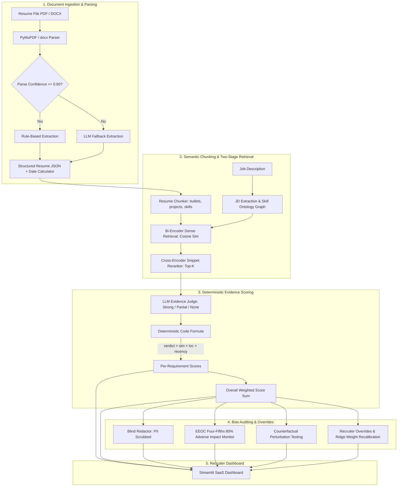

# RankWise: AI-Powered Candidate Ranking & Resume Screening System

[](https://www.python.org/downloads/)
[](https://fastapi.tiangolo.com/)
[](https://streamlit.io/)
[](https://opensource.org/licenses/MIT)

> **Core Principle:** *"The LLM reads and verifies evidence; deterministic code scores."*

---

## 1. System Architecture

RankWise is designed to overcome the critical pitfalls of legacy keyword-matching ATS systems and unconstrained generative AI scorers. The LLM extracts semantic information and categorizes evidence snippets (`Strong`, `Partial`, or `None`), but the **final numeric ranking score is always computed strictly by transparent, deterministic code formulas**.



---

## 2. Core Differences: Legacy ATS vs. RankWise

| Feature | Legacy ATS (e.g., Taleo, Workday) | Naive LLM Ranking | RankWise Hybrid System |
| :--- | :--- | :--- | :--- |
| **Matching Technique** | Keyword exact matching (TF-IDF / BM25) | Free-form prompt ("Score 1-100") | Two-stage dense retrieval + Cross-encoder reranking |
| **Keyword Stuffer Resistance** | ❌ Fails (ranks word-stuffed resumes #1) | ⚠️ Easily tricked by prompt injection | ✅ Immune (evidence judge verifies applied context) |
| **Scoring Transparency** | Black-box boolean / keyword count | Stochastic, non-reproducible | **100% Deterministic Code Formula** |
| **Synonym & Taxonomy Understanding** | ❌ None (*PyTorch* ≠ *Deep Learning*) | Unpredictable | ✅ Hierarchical Skill Ontology with partial credit |
| **Evidence Grounding** | None | Hallucinated summaries | Grounded text snippets with exact character offsets |
| **Bias Mitigation** | None | Disclaimer only | Real Blind Mode, Counterfactual Swaps, EEOC 80% Rule |
| **Auditability** | Limited | None | Immutable SQLite / Postgres Audit Log |

---

## 3. Key Design Decisions

### Why the LLM Never Sets the Final Numeric Score
Generative LLMs are prone to score drift, hallucination, non-deterministic variance across temperatures, and demographic token sensitivity. In RankWise:
1. **The LLM provides categorical evidence verdicts only**: `Strong`, `Partial`, or `None`, backed by a one-line factual reason.
2. **Deterministic code computes the numbers**:
   $$\text{ReqScore} = \text{VerdictMultiplier} \times (0.45 \cdot \text{Sim} + 0.30 \cdot \text{LocWeight} + 0.15 \cdot \text{Recency} + 0.10 \cdot \text{Duration})$$
3. **If verdict is `None`**, the score is mathematically clamped to `0.0`, eliminating false positive keyword stuffing.
4. **Overall Score** is a transparent weighted sum of Must-Haves, Nice-to-Haves, Experience Fit, and Education Fit configured per job.
5. **Streamlined Recruiter Experience**: Focus is maintained on verified, auditable evidence and recruiter control (score overrides), without unverified generative narrative text.

---

## 4. Evaluation Benchmark Results

The ablation harness (`GET /api/evaluation/results`) compares three systems on a **synthetic, labeled dataset of 21 resumes across 3 roles** (15 for *Senior Backend & Distributed Systems*, 3 each for *Data Pipeline* and *ML/NLP*), including keyword-stuffer resumes. The "Full System" column runs the **real ranking pipeline** (chunking -> two-stage retrieval -> evidence verdict -> deterministic scoring); ground-truth labels are used only to compute the metrics, never to rank.

Main role (15 resumes, offline/mock mode with the built-in fallback encoder):

| Architecture | NDCG@5 | NDCG@10 | Precision@5 | MRR | Keyword-stuffer rank (of 15) |
| :--- | :---: | :---: | :---: | :---: | :---: |
| **Baseline ATS (TF-IDF)** | 0.917 | 0.960 | 0.800 | 1.000 | #5 |
| **Embeddings Only** | 0.835 | 0.886 | 0.800 | 1.000 | n/a |
| **RankWise Full System** | **1.000** | **1.000** | **1.000** | **1.000** | #10 |

**Limitations (be upfront about these):** the dataset is small and synthetic, so these numbers show the pipeline behaves sensibly, not that it generalizes. On the two 3-resume roles the Full System only ties or modestly beats the baseline, and the keyword-trap resume is *not* pushed down there. Results use the offline fallback encoder and the mock LLM; they will differ with sentence-transformers and a live LLM.

---
## 5. Quickstart & Setup Guide

### Prerequisites
- Python 3.11 or 3.12
- Windows, macOS, or Linux

### Installation

1. **Clone the repository and enter the directory**:
   ```bash
   git clone https://github.com/KunalP22-me/RankWise.git
   cd RankWise/backend
   ```

2. **Create and activate a virtual environment**:
   - Windows (PowerShell):
     ```powershell
     python -m venv venv
     .\venv\Scripts\Activate.ps1
     ```
   - macOS / Linux:
     ```bash
     python -m venv venv
     source venv/bin/activate
     ```

3. **Install dependencies**:
   ```bash
   cp ../.env.example .env        # Windows: copy ..\.env.example .env
   pip install -r requirements-core.txt
   ```
   `requirements-core.txt` is the minimal set (installs in ~1-2 minutes) and runs fully offline with the mock LLM. Use `pip install -r requirements.txt` for the complete stack (real sentence-transformers embeddings, live Gemini/OpenAI/Claude providers); it is a much larger download (PyTorch).

4. **Populate demo data (Seed script)**:
   ```bash
   python scripts/seed.py
   ```
   *This automatically creates demo jobs, ingests parsed candidate resumes, executes the ranking pipeline, generates the bias audit report, and seeds a recruiter override.*

5. **Start the FastAPI Backend** (Terminal 1):
   ```bash
   uvicorn app.main:app --reload --port 8000
   ```
   Interactive Swagger API docs available at: `http://127.0.0.1:8000/docs`

6. **Start the Streamlit Recruiter Dashboard** (Terminal 2):
   ```bash
   streamlit run streamlit_app.py
   ```
   Access the dashboard at: `http://localhost:8501`

---

## 6. Environment Variables (`.env`)

Configuration is managed via Pydantic Settings in `backend/app/config.py`. Copy `.env.example` to `backend/.env` to customize:

| Variable | Default | Description |
| :--- | :--- | :--- |
| `DATABASE_URL` | `sqlite:///./rankwise.db` | SQLAlchemy database URL (swappable to Postgres) |
| `LLM_PROVIDER` | `mock` | Active provider: `mock` (instant offline), `gemini`, `openai`, `claude`, `ollama` |
| `LLM_MODEL` | `gemini-3.8-flash` | LLM model identifier for live API calls |
| `GEMINI_API_KEY` | *(empty)* | Google Gemini API key |
| `OPENAI_API_KEY` | *(empty)* | OpenAI API key |
| `ANTHROPIC_API_KEY` | *(empty)* | Anthropic Claude API key |
| `BI_ENCODER_MODEL` | `all-MiniLM-L6-v2` | SentenceTransformers model for dense retrieval |
| `CROSS_ENCODER_MODEL` | `cross-encoder/ms-marco-MiniLM-L-6-v2` | Cross-encoder model for precision reranking |
| `PARSE_CONFIDENCE_THRESHOLD` | `0.60` | Threshold below which parser invokes LLM fallback |
| `COUNTERFACTUAL_DELTA_THRESHOLD` | `0.05` | Maximum allowable score delta on demographic swap |

> **Note on Mock vs. Live LLM:** By default, `LLM_PROVIDER=mock` runs with zero latency and requires no API keys. When using live providers like Gemini, ensure your API quota supports batch screening requests.

---

## 7. Testing

Run the automated test suite covering parsing, deterministic scoring math, EEOC bias detection, and API routes:
```bash
pytest -v tests
```

---

## 8. Ethical Considerations & Limitations

1. **Human-in-the-Loop Required**: RankWise is a decision-support system, not an autonomous hiring agent. Shortlisting and hiring decisions must always be confirmed by human recruiters.
2. **Blind Mode & Counterfactual Audits**: Proactively mitigates unconscious bias by redacting names, contact info, pronouns, and graduation years, and verifying score invariance.
3. **EEOC Adverse Impact Compliance**: Continuously reports the four-fifths (80%) ratio across demographic cohorts to prevent disparate impact.
4. **Scorer Attribute Isolation**: Strict unit tests assert that protected demographic attributes can never be passed as features into the scoring formulas.

